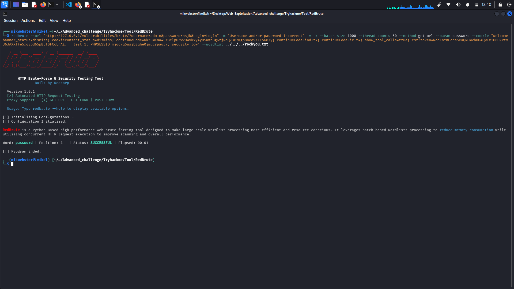
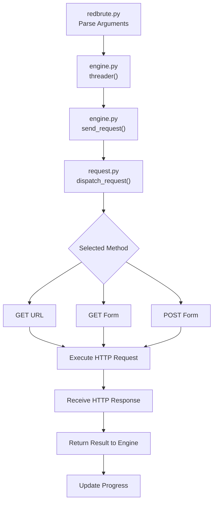
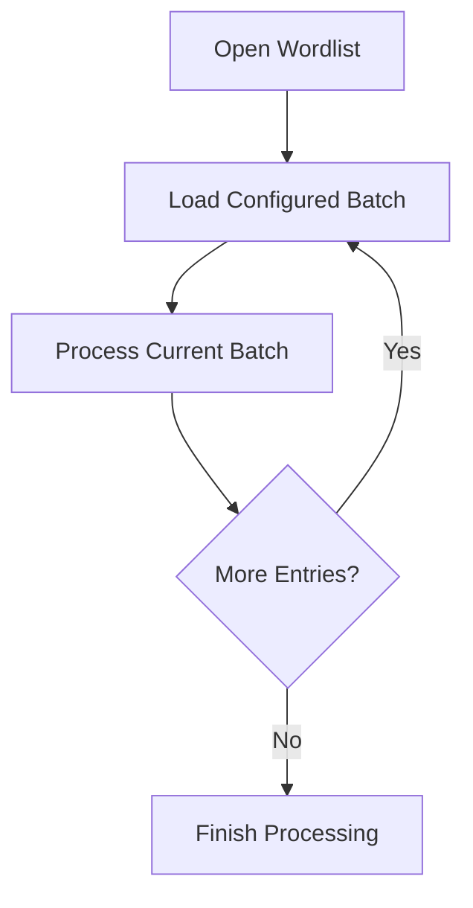

# REDBRUTE

<p align="center">
  
</p>

<p align="center">
  **A Python-Based Web Authentication Testing Tool**
</p>

<p align="center">
  Batch-Based Wordlist Processing • Concurrent HTTP Requests • Memory Efficiency
</p>

---

## Overview

**REDBRUTE** is a Python-based web authentication testing tool designed for efficient and resource-conscious wordlist processing in authorized security testing environments.

Unlike approaches that load an entire wordlist into memory, REDBRUTE uses a **batch-based processing architecture**, loading a specified number of entries at a time. Combined with concurrent HTTP request execution, this helps reduce memory consumption while maintaining efficient processing.

REDBRUTE is built with flexibility and resource efficiency in mind, allowing users to configure request methods, wordlists, batch sizes, and worker threads.

## Key Features

- **Batch-Based Wordlist Processing:** Loads wordlists in manageable batches instead of loading the entire file into memory.
- **Reduced Memory Consumption:** Helps minimize memory usage, particularly when processing extensive wordlists.
- **Concurrent Request Execution:** Uses multiple worker threads to process HTTP requests concurrently.
- **Custom Wordlists:** Supports user-provided wordlists alongside the included `rockyou.txt`.
- **Multiple HTTP Methods:** Supports GET URL, GET Form, and POST Form request configurations.
- **Custom Request Configuration:** Supports cookies, headers, proxies, and request timeouts.
- **Real-Time Progress Display:** Provides live feedback during execution.
- **SSL Configuration:** Allows users to configure SSL certificate verification.

## Screenshots

<p align="center">
  
</p>


## Supported Request Methods

REDBRUTE supports three request methods:

| Method | Description | Required Configuration |
|---|---|---|
| `gu` | GET URL | `--param` |
| `gf` | GET Form | `--auth-param` |
| `pf` | POST Form | `--data` and `--param` |

### 1. GET URL (`gu`)

Used when the authentication parameter is included in the URL query string.

The `--param` option identifies the parameter being tested.

### 2. GET Form (`gf`)

Used when authentication is handled through a GET-based form.

The `--auth-param` option specifies the valid authentication parameter required by the request configuration.

### 3. POST Form (`pf`)

Used when authentication is submitted through an HTTP POST form.

The `--data` option specifies the POST request body, while `--param` identifies the parameter being tested.

**Important:** Configure the required parameters according to the selected request method. Incorrect or missing parameters can result in invalid requests.

### Why Batch Processing Matters

Large wordlists can consume considerable memory when loaded entirely into RAM.

REDBRUTE addresses this through batch-based loading:

1. The wordlist is opened and processed incrementally.
2. A configurable number of entries is loaded into memory.
3. The current batch is processed.
4. The next batch is loaded as processing continues.

This approach avoids unnecessarily loading the entire wordlist into memory.

## Performance and Resource Configuration

REDBRUTE allows users to configure batch size and worker thread count to accommodate different hardware capabilities.

| Configuration | Default | Purpose |
|---|---:|---|
| Batch Size | 1,000 | Number of words loaded per batch |
| Thread Count | 100 | Number of concurrent worker threads |
| Timeout | 4 seconds | Maximum request waiting time |

### Recommended Configuration

The default settings are configurable and should be adjusted according to the available hardware and testing environment.

- **Thread Count:** For authorized live-site testing, use a conservative setting below 20 and respect the site's rate limits. Higher concurrency can overwhelm services or trigger defensive controls.
- **Batch Size:** If working with limited RAM or CPU resources, consider reducing the batch size below 1,000.
- **Timeout:** Adjust the timeout based on the response characteristics of the authorized test environment.

A larger batch size does not automatically mean faster execution. The objective is to balance memory consumption, processing efficiency, and available system resources.

## Architecture

REDBRUTE uses a modular architecture, separating configuration, wordlist processing, request execution, and terminal presentation.

The `architecture/` directory contains additional documentation explaining the internal design.

### Project Structure

```text
REDBRUTE/
│
├── assets/
│   └── redbrute-banner.png
│
├── architecture/
│   └── architecture documentation
│
├── screenshots/
│   ├── redbrute-1.png
│   
│
├── banner.py
├── config.py
├── engine.py
├── loadBatch.py
├── request.py
├── redbrute.py
└── README.md
```

### Module Responsibilities

| Module | Responsibility |
|---|---|
| `redbrute.py` | Main entry point and command-line argument parsing |
| `engine.py` | Main execution engine and threading coordination |
| `request.py` | HTTP request dispatching and response handling |
| `loadBatch.py` | Incremental wordlist loading and batch management |
| `config.py` | Central configuration management |
| `banner.py` | Terminal banner and presentation |

### Execution Flow



### Wordlist Processing Flow



## Command-Line Options

| Option | Description | Default |
|---|---|---|
| `--wordlist` | Specify a custom wordlist |
| `--data` | Specify HTTP request data | None |
| `--param` | Specify the parameter being tested | None |
| `--auth-param` | Specify the GET Form authentication parameter | None |
| `-v, --verbose` | Enable verbose output | Disabled |
| `-k, --verify` | Disable SSL certificate verification | Disabled |
| `--cookie` | Specify HTTP cookies | None |
| `--header` | Specify custom HTTP headers | None |
| `--proxy` | Specify a proxy URL | None |
| `--timeout` | Specify request timeout | 4 seconds |
| `--batch-size` | Specify words loaded per batch | 1,000 |
| `--thread-counts` | Specify concurrent worker threads | 100 |
| `--method` | Select the HTTP request method | `pf` |

For the complete list of available arguments and their accepted values, consult the command-line help.

## Design Philosophy

REDBRUTE was designed around three primary considerations:

**1. Memory Efficiency**

Rather than loading extensive wordlists into memory at once, REDBRUTE processes them incrementally through configurable batches.

**2. Controlled Concurrency**

Concurrent request execution helps improve processing efficiency, while configurable worker counts allow users to manage resource consumption.

**3. Modular Architecture**

Separating the engine, request handling, configuration, and wordlist management makes the project easier to understand, maintain, and extend.

## Responsible Use

REDBRUTE is intended for authorized security assessments, controlled penetration-testing environments, and educational laboratories.

Only test systems for which you have explicit permission. Respect service rate limits and avoid disrupting production systems.

## License

See the repository's license file for usage and distribution terms.